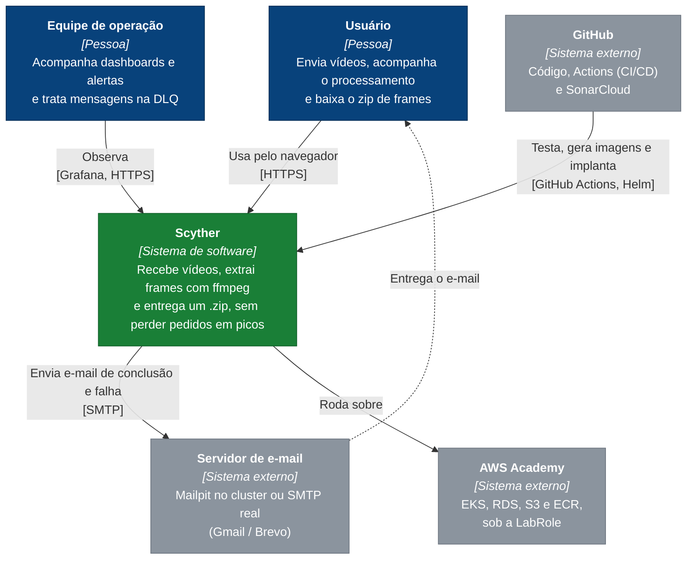
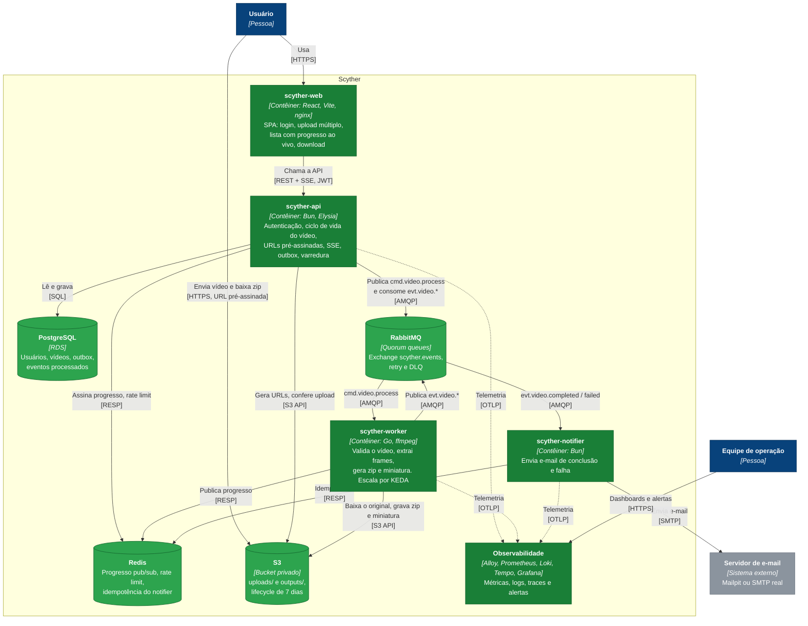
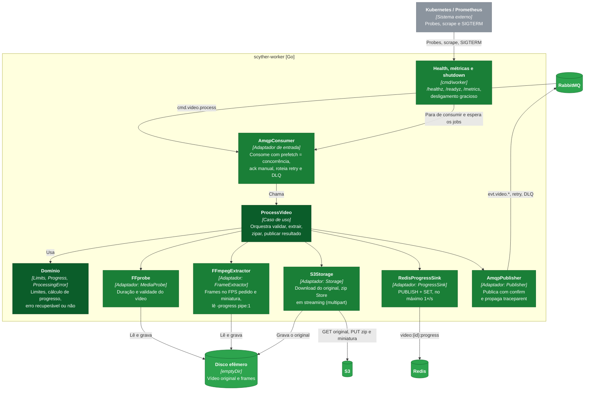

# Diagramas C4 — Scyther

Visão da arquitetura em três níveis do [modelo C4](https://c4model.com/): contexto, contêineres e componentes do worker. Complementam os [diagramas UML](README.md), que detalham classes, sequências e estados. A fonte é o Mermaid deste arquivo (o GitHub renderiza direto).

Legenda: azul = pessoa · verde = sistema, contêiner ou componente do Scyther · cinza = sistema externo · cilindro = armazenamento de dados.

## C1. Contexto

Quem usa o Scyther e com quais sistemas externos ele conversa.

## C2. Contêineres

As unidades implantáveis e os armazenamentos de dados dentro do Scyther. Cada contêiner de aplicação é um repositório (ADR [0002](../adr/0002-um-repositorio-por-componente-e-dono-unico-dos-dados.md)). As mensagens entre eles estão nos [contratos](../contracts/README.md).

## C3. Componentes do scyther-worker

O worker por dentro: hexagonal leve, com o caso de uso no centro e um adaptador por porta. As classes de cada componente estão no [diagrama UML 6](README.md#6-worker-go).

